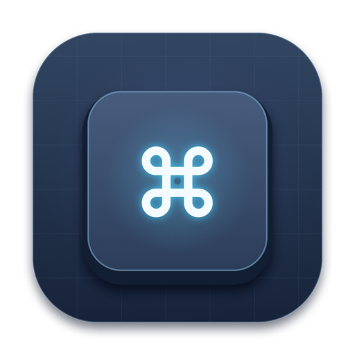
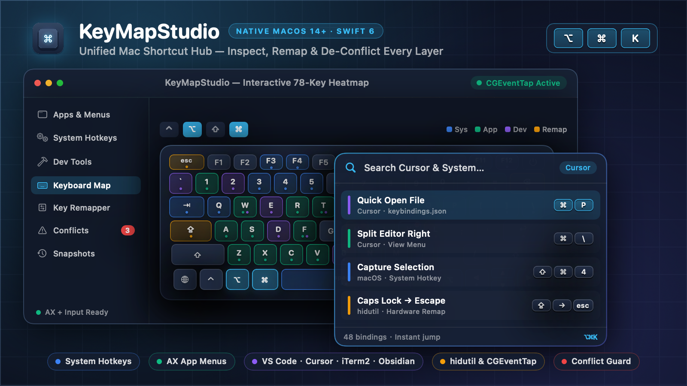
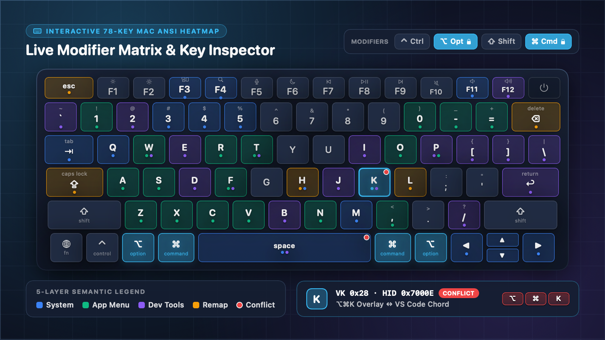
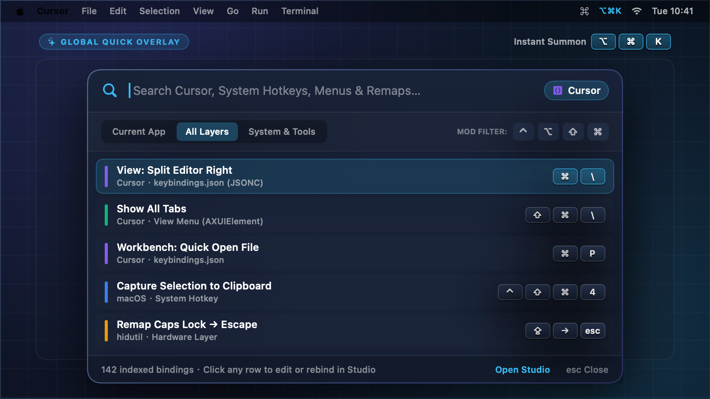
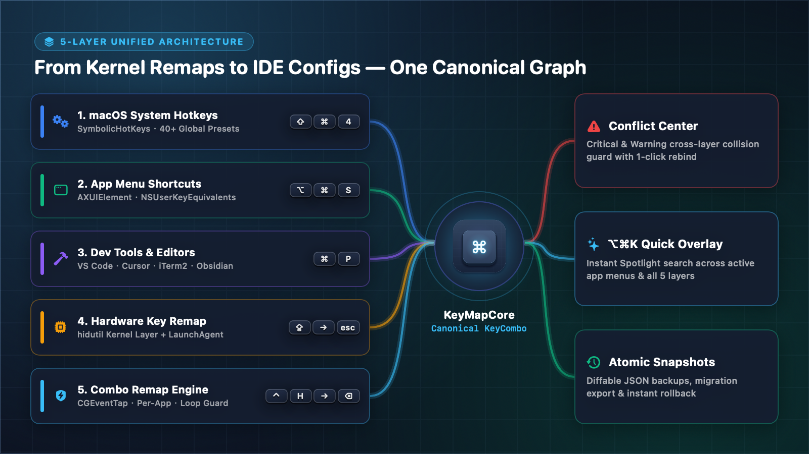
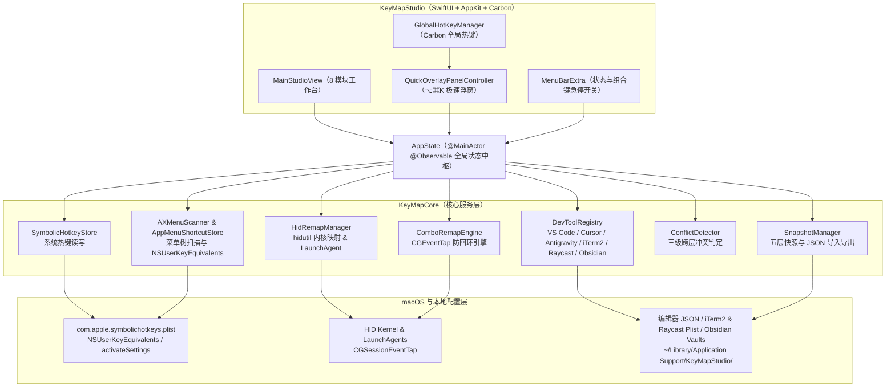

<div align="center">



# KeyMapStudio

**macOS 全局快捷键中枢 — 系统热键、应用菜单、开发工具与底层键位重映射一站式可视化管理**

[](https://github.com/xialeizhou77/KeyMapStudio/releases/latest)
[](https://github.com/xialeizhou77/KeyMapStudio/releases)
[](https://github.com/xialeizhou77/KeyMapStudio/releases)
[](https://swift.org)
[](https://github.com/xialeizhou77/KeyMapStudio/actions/workflows/ci.yml)
[](LICENSE)
[](https://github.com/xialeizhou77/KeyMapStudio/releases)

**简体中文** | [English](README_EN.md)

[下载安装](#-下载与安装download) • [核心亮点](#-核心亮点) • [方案对比](#-与传统方案对比) • [支持范围](#-支持范围矩阵) • [技术架构](#-技术架构) • [快速上手](#-快速上手) • [使用指南](docs/USER_GUIDE.md) • [源码构建](#-源码构建与测试)

<br />



</div>

---

## 💡 为什么需要 KeyMapStudio？

在 macOS 上管理快捷键长期处于“碎片化”状态：系统热键藏在多层偏好设置中，应用菜单改键要手敲隐藏的 `NSUserKeyEquivalents` 字符串，VS Code / Cursor / iTerm2 / Obsidian 各自维护独立的 JSON 或 Plist，而底层硬件键位修改又得自己拼凑 `hidutil` 十六进制代码与 `LaunchAgent`。一旦快捷键撞车，往往只能盲猜排查。

**KeyMapStudio** 使用 **SwiftUI + AppKit + Swift 6** 原生构建，将 **macOS 系统热键、实时应用菜单、开发工具配置、内核 HID 单键映射、应用级组合键引擎** 与 **跨层全局冲突中心** 收纳进同一套清爽直观的桌面工作台与 `⌥⌘K` 极速浮窗中。

---

## 📥 下载与安装（Download）

请根据你的 Mac 处理器架构选择对应的安装包（[查看全部历史版本](https://github.com/xialeizhou77/KeyMapStudio/releases)）：

| 芯片架构 | 适用机型 | 推荐安装包 (DMG) | 便携压缩包 (ZIP) | 校验文件 |
| :--- | :--- | :--- | :--- | :--- |
| **Apple Silicon** (`arm64`) | M1 / M2 / M3 / M4 系列 Mac | [KeyMapStudio-AppleSilicon-arm64.dmg](https://github.com/xialeizhou77/KeyMapStudio/releases/latest/download/KeyMapStudio-AppleSilicon-arm64.dmg) | [KeyMapStudio-AppleSilicon-arm64.zip](https://github.com/xialeizhou77/KeyMapStudio/releases/latest/download/KeyMapStudio-AppleSilicon-arm64.zip) | [SHA256SUMS.txt](https://github.com/xialeizhou77/KeyMapStudio/releases/latest/download/SHA256SUMS.txt) |
| **Intel** (`x86_64`) | 基于 Intel 处理器的 Mac | [KeyMapStudio-Intel-x86_64.dmg](https://github.com/xialeizhou77/KeyMapStudio/releases/latest/download/KeyMapStudio-Intel-x86_64.dmg) | [KeyMapStudio-Intel-x86_64.zip](https://github.com/xialeizhou77/KeyMapStudio/releases/latest/download/KeyMapStudio-Intel-x86_64.zip) | [SHA256SUMS.txt](https://github.com/xialeizhou77/KeyMapStudio/releases/latest/download/SHA256SUMS.txt) |

<details>
<summary>🔍 不确定自己的 Mac 是哪种芯片？点此查看判断方法与 SHA256 校验命令</summary>

1. **图形界面查看**：点击屏幕左上角 ** → 关于本机**
   - 显示 **Apple M1 / M2 / M3 / M4** 芯片 → 下载 **Apple Silicon (`arm64`)** 版本
   - 显示 **Intel Core ...** 处理器 → 下载 **Intel (`x86_64`)** 版本
2. **终端命令查看**：
   ```bash
   uname -m
   # 输出 arm64 表示 Apple Silicon；输出 x86_64 表示 Intel
   ```
3. **验证下载文件完整性（可选）**：
   ```bash
   shasum -a 256 -c SHA256SUMS.txt --ignore-missing
   ```

</details>

### ⚠️ 首次运行解除 Gatekeeper 隔离（重要）

KeyMapStudio 为独立开源免费软件，Release 产物采用本地 **ad-hoc 签名**（`codesign --force --deep --sign -`），尚未购买付费 Apple Developer ID 证书进行公证（Notarization）。因此首次从网络下载并拖入 `/Applications` 后，macOS Gatekeeper 可能会提示 **“无法打开，因为无法验证开发者”** 或 **“已损坏，无法打开”**。

安装到 `/Applications/KeyMapStudio.app` 后，请在「终端」执行以下任一方式解除隔离属性即可正常运行：

```bash
# 方式一（推荐）：移除下载文件的 macOS 隔离标记
xattr -cr /Applications/KeyMapStudio.app
```

> **方式二（图形界面）**：尝试双击打开并关闭提示框后，前往 **系统设置 → 隐私与安全性 → 安全性** 底部点击 **“仍要打开”**。

---

## ✨ 核心亮点

### 1. 交互式 78 键虚拟键盘热图（Interactive Keyboard）



- **Mac ANSI 78 键物理布局**：精准还原 6 行 Mac 键盘与折叠方向键布局，键帽即时呈现各层绑定密度与来源分布。
- **物理修饰键实时联动**：按住实体键盘上的 `⌃ / ⌥ / ⇧ / ⌘`（以及 `🌐 fn`）时，画布即时高亮对应组合前缀下的所有键位绑定；也支持鼠标点击顶部 **修饰键胶囊** 锁定组合前缀。
- **五色语义 + 冲突红点图例**：**蓝色**（系统快捷键）、**绿色**（应用菜单）、**紫色**（开发工具）、**橙色**（底层改键 / 重映射）、**右上角红点**（存在冲突），空闲按键一目了然。
- **键帽详情与行内重绑**：点击任意可绑定键帽，即可查看 `VirtualKey` 十六进制/十进制键码与 `HID Usage`（`0x7000000...`），并在下方列表直接行内重录快捷键或一键定位至源模块。

---

### 2. 全局极速浮窗（Quick Overlay）与实时菜单捕捉



- **任意位置 `⌥⌘K` 瞬时呼出**：通过 Carbon 全局热键（默认 `⌥⌘K`，可在「权限与设置」中自定义并支持一键恢复默认）呼出无激活抢占式浮动面板（`NSPanel`）。
- **自动捕捉前台应用菜单**：浮窗弹出前自动识别当前正在使用的前台应用（如 Finder、Safari、Xcode、VS Code），通过 Accessibility 树实时抓取全部菜单快捷键；若前台为已集成的开发工具，还会自动合并其配置文件中的自定义键位。
- **三段范围与修饰键筛选**：支持在 **「当前应用」/「全部」/「系统与工具」** 之间切换，结合 `⌃` `⌥` `⇧` `⌘` 过滤胶囊与模糊搜索（同时匹配命令名称、路径、`⌥⌘K` 符号及 `alt+cmd+k` 写法）。
- **直达主窗口编辑**：点击浮窗内任意条目即可自动切换至主窗口对应模块并选中该快捷键，立即进行修改或排障；按 `Esc` 或点击外部即刻收起。

---

### 3. 五层统一中枢、底层改键与跨层冲突诊断



- **应用菜单覆写 (`NSUserKeyEquivalents`)**：支持单级菜单标题或 `->` 多级嵌套路径（底层自动编码为 `\u{001B}` 层级路径，避免同名菜单误改），支持全局覆盖（`NSGlobalDomain`），修改后提示一键 **「重启应用以生效」**。
- **macOS 系统快捷键 (`SymbolicHotKeys`)**：内置 **53 项常用系统热键目录**（聚焦搜索、输入法、截屏、调度中心与空间、程序坞与系统、键盘与焦点、辅助功能）并自动合并用户现有自定义扩展条目，写入后调用 `activateSettings -u` 即时刷新。
- **双引擎底层改键**：
  - **硬件单键重映射 (`hidutil`)**：直接操作内核 HID 映射表，零后台常驻开销；内置 4 套高频预设（含 `Caps Lock → Escape`、`Caps Lock → Left Control` 等）与自由组合，支持一键生成 `LaunchAgent` 开机自启或秒级清空还原。
  - **组合键重映射引擎 (`CGEventTap`)**：支持跨应用全局转发或仅针对指定 `bundleID` 生效（应用级规则优先于全局规则）；内置 `0x4B4D5354` 防回环标记、录制快捷键时自动暂停，以及菜单栏 **「紧急停止所有组合键改键」** 开关。
- **跨层全局冲突中心**：独创 **高危 (Critical) / 警告 (Warning) / 提示 (Info)** 三级判定——严格区分“同应用/同全局作用域撞车”与“不同应用各自独立菜单”，杜绝跨 App 误报。
- **全量配置快照与换机迁移**：将 5 大层级配置打包为本地快照（`~/Library/Application Support/KeyMapStudio/snapshots/`），支持一键安全回滚与 JSON 导入导出。

---

## 🆚 与传统方案对比

| 能力维度 | **KeyMapStudio** | macOS 系统设置 | CheatSheet | Karabiner-Elements |
| :--- | :---: | :---: | :---: | :---: |
| **macOS 系统热键图形化改键 / 启停 / 还原** | ✅ 53+ 项即改即生效 | ⚠️ 分散且无还原提示 | ❌ 仅查看 | ❌ 不管理 `SymbolicHotKeys` |
| **实时扫描前台 App 菜单 + 浮窗速查 (`⌥⌘K`)** | ✅ 实时 AX 扫描 + 搜索过滤 | ❌ 需手动盲填菜单名 | ✅ 长按 ⌘ 弹出（已停更） | ❌ |
| **App 菜单自定义 (`NSUserKeyEquivalents`)** | ✅ 支持 `->` 嵌套路径 & 一键重启 App | ⚠️ 仅纯文本录入 | ❌ | ❌ |
| **开发工具配置聚合 (IDE / 终端 / 笔记 / 启动器)** | ✅ VS Code / Cursor / Antigravity / iTerm2 / Obsidian / Raycast | ❌ | ❌ | ❌ |
| **内核级硬件单键改键 (`hidutil` + LaunchAgent)** | ✅ 零常驻内核映射 + 一键归零 | ⚠️ 仅有限修饰键互换 | ❌ | ✅ 需内核/DriverKit 扩展 |
| **按应用生效的组合键重映射 (`CGEventTap`)** | ✅ 支持全局/分应用 + 防回环 + 急停 | ❌ | ❌ | ✅ 复杂 JSON/规则 DSL |
| **跨层全局快捷键冲突检测** | ✅ 高危 / 警告 / 提示三级识别 | ⚠️ 仅系统内部极少提示 | ❌ | ❌ |
| **全量快照备份与 JSON 换机迁移** | ✅ 五层一体快照回滚 | ❌ | ❌ | ⚠️ 仅自身规则配置 |
| **安装复杂度与侵入性** | 🟢 单体原生 App，无虚拟驱动 | 🟢 系统内置 | 🟡 已停止维护 | 🟡 需安装虚拟 HID 驱动与后台守护 |

---

## 🧰 支持范围矩阵

| 管理层级 | 底层机制 / 配置位置 | 权限能力 | 支持操作 |
| :--- | :--- | :---: | :--- |
| **macOS 系统快捷键** | `~/Library/Preferences/com.apple.symbolichotkeys.plist` + `activateSettings -u` | **读 / 写** | 分类浏览、启用/禁用、键位重录、恢复默认 |
| **应用菜单快捷键** | `AXUIElement` 菜单树扫描 + `NSUserKeyEquivalents` / `com.apple.universalaccess` | **读 / 写** | 实时扫描（需辅助功能）、新增/修改单级或 `->` 多级菜单、全局 `NSGlobalDomain` 覆盖、一键重启 App、移除覆盖 |
| **硬件单键重映射** | `/usr/bin/hidutil` + `~/Library/LaunchAgents/com.keymapstudio.hidremap.plist` | **读 / 写** | 4 项内置预设、自定义任意 HID Usage 映射、立即应用、LaunchAgent 开机自启、一键重置清空 |
| **组合键重映射** | `CGEventTap` (`kCGSessionEventTap`) + `combo_rules.json` | **实时拦截** | 全局或指定 `bundleID` 转发、`0x4B4D5354` 防回环、录制自动暂停、菜单栏急停开关 |
| **VS Code** (`com.microsoft.VSCode`) | `~/Library/Application Support/Code/User/keybindings.json` | **读 / 写** | JSONC 注释解析、`-command` 禁用规则、修改/新增/删除、`when` 上下文编辑 |
| **Cursor** (`com.todesktop.230313mzl4w4u92`) | `~/Library/Application Support/Cursor/User/keybindings.json` | **读 / 写** | JSONC 注释解析、`-command` 禁用规则、修改/新增/删除、`when` 上下文编辑 |
| **Antigravity** (`com.google.antigravity`) | `~/Library/Application Support/Antigravity/User/keybindings.json` | **读 / 写** | JSONC 注释解析、`-command` 禁用规则、修改/新增/删除、`when` 上下文编辑 |
| **iTerm2** (`com.googlecode.iterm2`) | `~/Library/Preferences/com.googlecode.iterm2.plist` | **读 / 写** | `GlobalKeyMap` 与首个 Profile `Keyboard Map` 读写与动作解析 |
| **Raycast** (`com.raycast.macos`) | `~/Library/Preferences/com.raycast.macos.plist` | **只读** | 解析 `raycastGlobalHotkey` 与命令热键并纳入全局冲突中心（安全保护不改写） |
| **Obsidian** (`md.obsidian`) | `~/Library/Application Support/obsidian/obsidian.json` → `<Vault>/.obsidian/hotkeys.json` | **读 / 写** | 自动发现多 Vault 仓库并分别读写热键配置 |

---

## 🏗️ 技术架构

KeyMapStudio 采用核心库与界面分离的 Swift Package 架构：`KeyMapCore` 封装纯数据模型、系统持久化存储、适配器、事件引擎与冲突分析（100% 可单测），`KeyMapStudio` 负责原生 SwiftUI 界面、AppKit 非激活浮窗与菜单栏常驻控制。



---

## 🚀 快速上手

1. **安装与首次放行**：下载对应芯片架构的 `.dmg`，拖入 `/Applications` 后执行 `xattr -cr /Applications/KeyMapStudio.app` 并启动。
2. **授予必要权限**：在侧边栏进入 **「权限与设置」**，按引导开启 **辅助功能（Accessibility）**（用于实时扫描应用菜单）；若需启用组合键转发引擎，一并开启 **输入监控（Input Monitoring）**。
3. **创建基线快照**：在做任何批量改键前，前往 **「快照与备份」** 点击 **「立即创建快照」**，为当前所有系统、菜单与工具配置留好“安全还原点”。
4. **开始探索与调优**：
   - 随时按下 `⌥⌘K` 呼出极速浮窗查看当前应用快捷键；
   - 进入 **「交互式键盘」** 按住 `⌘ / ⌥ / ⌃ / ⇧` 直观查看键盘占用热图；
   - 打开 **「冲突中心」** 优先清理标红的 **高危冲突**。

📖 想深入了解全部 8 大功能模块、快捷键录制规则与命令行彻底卸载/还原方法？请阅读完整说明书：

👉 **[完整中文使用说明书（docs/USER_GUIDE.md）](docs/USER_GUIDE.md)**

---

## 🛠️ 源码构建与测试

### 环境要求

- **操作系统**：macOS 14.0（Sonoma）及以上
- **工具链**：Swift 6.0+（Xcode 16+ 或 Apple Command Line Tools）

### 常用开发命令

```bash
# 1. 克隆仓库
git clone https://github.com/xialeizhou77/KeyMapStudio.git
cd KeyMapStudio

# 2. 运行单元测试（使用 Swift Testing，全量隔离临时目录，不触及系统真实配置）
swift test
# 若在纯 CommandLineTools（无 Xcode.app）的 macOS 新版 SDK 环境下运行：
# SDKROOT=/Library/Developer/CommandLineTools/SDKs/MacOSX26.5.sdk swift test -Xswiftc -plugin-path -Xswiftc /Library/Developer/CommandLineTools/usr/lib/swift/host/plugins/testing

# 3. 编译打包并直接启动本地 .app（支持传入 debug/release 与 arm64/x86_64/host）
./scripts/run.sh

# 4. 仅构建并签名 .app 包（输出至 build/KeyMapStudio.app）
./scripts/bundle_app.sh release host

# 5. 一键构建 Apple Silicon + Intel 双架构正式发布产物（输出 DMG / ZIP / SHA256SUMS.txt 至 dist/）
./scripts/package_release.sh
```

---

## 🤝 贡献指南与开源协议

欢迎提交 Issue 反馈 Bug、提出新功能建议，或通过 Pull Request 贡献新的开发工具适配器、键盘布局支持与文档改进！

- 📘 参与开发请阅读：[贡献指南（CONTRIBUTING.md）](CONTRIBUTING.md)
- 🐛 提交 Bug 报告：[Bug Report 模板](.github/ISSUE_TEMPLATE/bug_report.md)
- 💡 提出新功能建议：[Feature Request 模板](.github/ISSUE_TEMPLATE/feature_request.md)
- 📋 查看版本历史：[更新日志（CHANGELOG.md）](CHANGELOG.md)

本项目基于 **[MIT License](LICENSE)** 开源发布。
