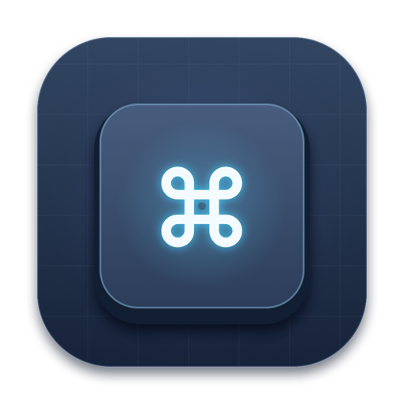
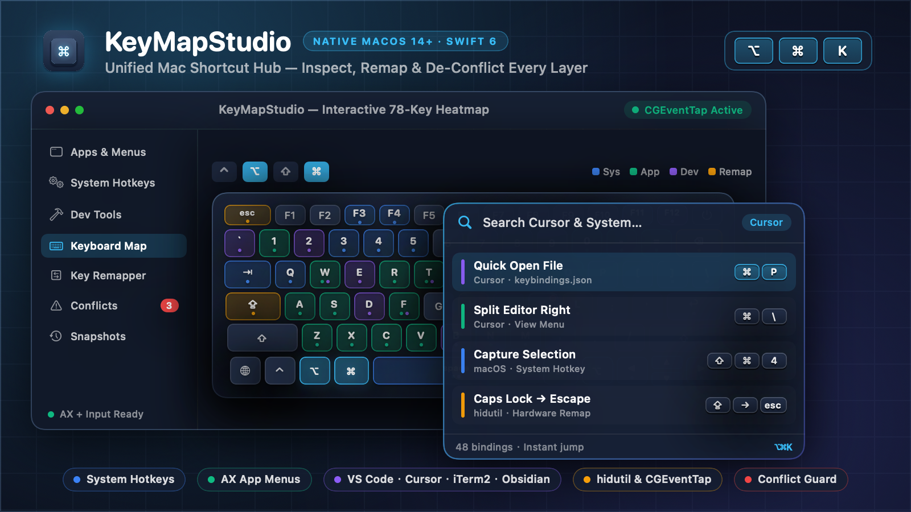
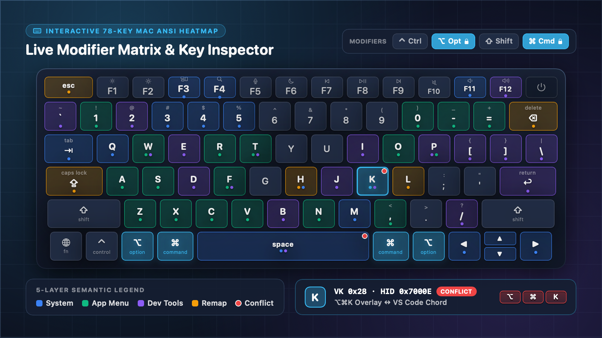
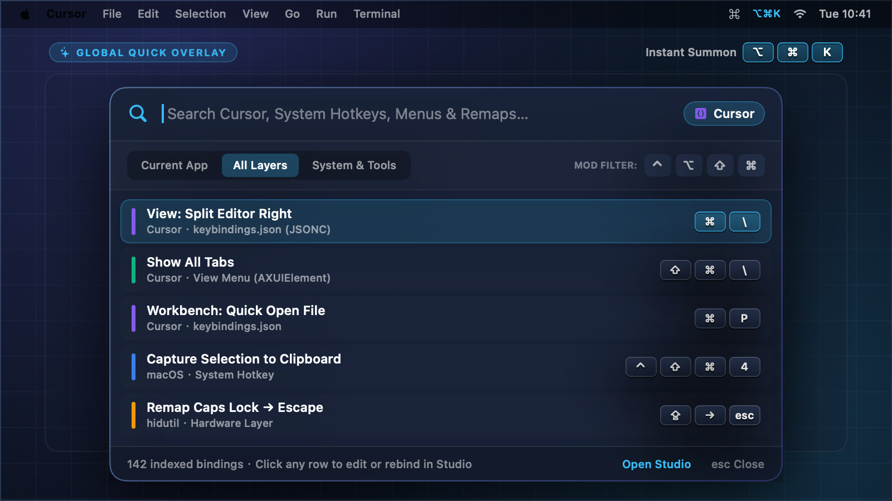
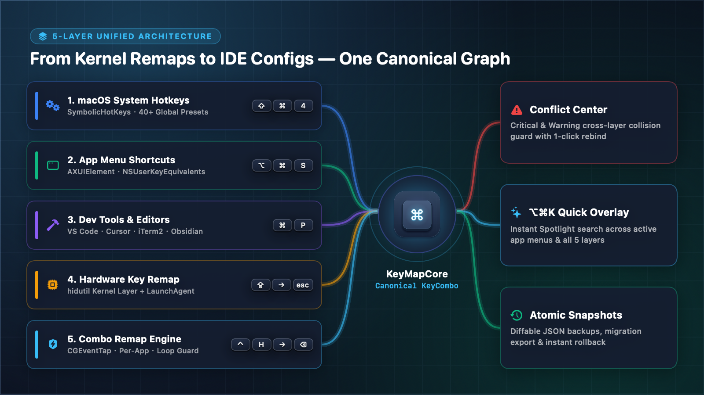
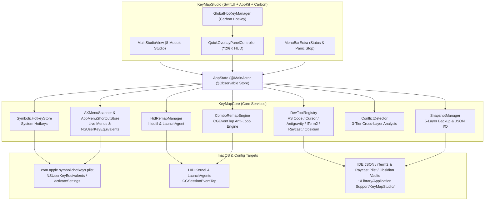

<div align="center">



# KeyMapStudio

**The Unified macOS Shortcut Command Center — System Hotkeys, Live App Menus, Developer Tools & Low-Level Key Remapping in One Native Studio**

[](https://github.com/xialeizhou77/KeyMapStudio/releases/latest)
[](https://github.com/xialeizhou77/KeyMapStudio/releases)
[](https://github.com/xialeizhou77/KeyMapStudio/releases)
[](https://swift.org)
[](https://github.com/xialeizhou77/KeyMapStudio/actions/workflows/ci.yml)
[](LICENSE)
[](https://github.com/xialeizhou77/KeyMapStudio/releases)

[简体中文](README.md) | **English**

[Download](#-download--installation) • [Features](#-core-features) • [Comparison](#-comparison-with-alternatives) • [Supported Stack](#-supported-ecosystem-matrix) • [Architecture](#-technical-architecture) • [Quick Start](#-quick-start) • [User Guide](docs/USER_GUIDE.md) • [Build from Source](#-build-from-source--testing)

<br />



</div>

---

## 💡 Why KeyMapStudio?

Keyboard shortcuts on macOS are scattered across disconnected layers: system hotkeys live inside nested System Settings panes, custom app menu overrides require typing invisible `NSUserKeyEquivalents` strings, developer tools like VS Code / Cursor / iTerm2 / Obsidian store bindings in separate JSON or plist files, and hardware remaps demand hand-crafted `hidutil` hex payloads and `LaunchAgent` plists. When shortcuts collide, troubleshooting is pure guesswork.

Built natively with **SwiftUI + AppKit + Swift 6**, **KeyMapStudio** unifies **macOS system symbolic hotkeys, live Accessibility app menus, developer tool keymaps, kernel-level HID remaps, per-app `CGEventTap` combo forwarding**, and a **3-tier global Conflict Center** inside one clean macOS studio and an instant `⌥⌘K` Spotlight-style Quick Overlay.

---

## 📥 Download & Installation

Choose the build matching your Mac processor architecture ([view all releases](https://github.com/xialeizhou77/KeyMapStudio/releases)):

| Architecture | Compatible Macs | Recommended (DMG) | Portable Archive (ZIP) | Checksums |
| :--- | :--- | :--- | :--- | :--- |
| **Apple Silicon** (`arm64`) | M1 / M2 / M3 / M4 Macs | [KeyMapStudio-AppleSilicon-arm64.dmg](https://github.com/xialeizhou77/KeyMapStudio/releases/latest/download/KeyMapStudio-AppleSilicon-arm64.dmg) | [KeyMapStudio-AppleSilicon-arm64.zip](https://github.com/xialeizhou77/KeyMapStudio/releases/latest/download/KeyMapStudio-AppleSilicon-arm64.zip) | [SHA256SUMS.txt](https://github.com/xialeizhou77/KeyMapStudio/releases/latest/download/SHA256SUMS.txt) |
| **Intel** (`x86_64`) | Intel-based Macs | [KeyMapStudio-Intel-x86_64.dmg](https://github.com/xialeizhou77/KeyMapStudio/releases/latest/download/KeyMapStudio-Intel-x86_64.dmg) | [KeyMapStudio-Intel-x86_64.zip](https://github.com/xialeizhou77/KeyMapStudio/releases/latest/download/KeyMapStudio-Intel-x86_64.zip) | [SHA256SUMS.txt](https://github.com/xialeizhou77/KeyMapStudio/releases/latest/download/SHA256SUMS.txt) |

<details>
<summary>🔍 Not sure which Mac chip you have? Click to check & verify SHA256 checksums</summary>

1. **Via GUI**: Click ** → About This Mac**
   - Shows **Apple M1 / M2 / M3 / M4** chip → download **Apple Silicon (`arm64`)**
   - Shows **Intel Core ...** processor → download **Intel (`x86_64`)**
2. **Via Terminal**:
   ```bash
   uname -m
   # arm64 = Apple Silicon; x86_64 = Intel
   ```
3. **Verify download checksums (optional)**:
   ```bash
   shasum -a 256 -c SHA256SUMS.txt --ignore-missing
   ```

</details>

### ⚠️ Gatekeeper First-Launch Instructions (Important)

KeyMapStudio is free, open-source software distributed with an **ad-hoc code signature** (`codesign --force --deep --sign -`) and is not notarized with a paid Apple Developer ID certificate. Because of this, macOS Gatekeeper attaches a `com.apple.quarantine` attribute to downloaded builds and may warn that *"KeyMapStudio cannot be opened because the developer cannot be verified"* or *"is damaged and can't be opened"*.

After dragging `KeyMapStudio.app` into `/Applications`, clear the quarantine attribute in Terminal:

```bash
# Recommended: remove macOS quarantine flag after copying to /Applications
xattr -cr /Applications/KeyMapStudio.app
```

> **GUI alternative**: Attempt to open the app once, dismiss the dialog, then go to **System Settings → Privacy & Security** and click **Open Anyway**.

---

## ✨ Core Features

### 1. Interactive 78-Key Mac Keyboard Heatmap



- **Full ANSI 78-Key Physical Layout**: Faithful 6-row Mac keyboard chassis with stacked arrow cluster, showing real-time binding density across every keycap.
- **Live Physical Modifier Tracking**: Hold `⌃ / ⌥ / ⇧ / ⌘` (and `🌐 fn`) on your physical keyboard to highlight keys bound to that modifier combination in real time—or click the top modifier pills (`Ctrl` / `Opt` / `Shift` / `Cmd`) to lock a prefix with your mouse.
- **5-Color Semantic Legend + Conflict Dots**: **Blue** (System Hotkeys), **Green** (App Menus), **Purple** (Developer Tools), **Orange** (HID & Combo Remaps), and a **Red Dot** on conflicting keys.
- **Per-Key Technical Inspector & Inline Rebinding**: Click any bindable keycap to inspect its `VirtualKey` hex/decimal code and `HID Usage` (`0x7000000...`), filter by source, rebind editable shortcuts inline, or jump straight to the owning module.

---

### 2. Instant `⌥⌘K` Quick Overlay & Live Menu Capture



- **Global `⌥⌘K` Summon**: Press `⌥⌘K` (customizable in **Permissions & Settings**) anywhere on macOS to raise a non-activating floating `NSPanel` via Carbon `RegisterEventHotKey`.
- **Frontmost App Auto-Capture**: Before displaying the HUD, KeyMapStudio snapshots the active external app (`NSWorkspace.shared.frontmostApplication`), scans its live Accessibility menu bar, and merges matching developer tool bindings automatically.
- **3-Scope Switching & Modifier Pills**: Toggle between **Current App (`当前应用`)**, **All (`全部`)**, and **System & Tools (`系统与工具`)**, combine `⌃ ⌥ ⇧ ⌘` filter pills, and fuzzy-search by command name, app name, `⌥⌘K` symbol, or `alt+cmd+k` notation.
- **One-Click Jump to Edit**: Click any row in the overlay to focus that exact shortcut inside the main studio inspector; press `Esc` or click outside to dismiss.

---

### 3. Five-Layer Unified Hub, Dual-Engine Remapper & Conflict Center



- **App Menu Overrides (`NSUserKeyEquivalents`)**: Supports both single-level titles and nested `->` menu paths (encoded with `\u{001B}` hierarchy separators for exact matching), global `NSGlobalDomain` overrides, and one-click target app restart so changes apply immediately.
- **macOS System Hotkeys (`SymbolicHotKeys`)**: Ships with **53 curated built-in entries** across 7 categories (Spotlight, Input Sources, Screenshots, Mission Control & Spaces, Dock & System, Keyboard & Focus, Accessibility) plus user custom IDs from `com.apple.symbolichotkeys.plist`, calling `activateSettings -u` on save.
- **Dual-Engine Low-Level Remapper**:
  - **Hardware Single-Key Remap (`hidutil`)**: Kernel-level HID mapping with zero background daemon overhead, 4 ready-to-use presets (including `Caps Lock → Escape`, `Caps Lock → Left Control`, etc.), custom rules, and optional `LaunchAgent` login persistence.
  - **Combo Remap Engine (`CGEventTap`)**: Intercepts and translates key combos globally or per `bundleID` (app-scoped rules take precedence over global rules), protected by a `0x4B4D5354` (`'KMST'`) anti-loop tag, automatic pause during shortcut recording, and a menu-bar **Emergency Stop**.
- **3-Tier Cross-Layer Conflict Center**: Classifies collisions into **Critical (高危)**, **Warning (警告)**, and **Info (提示)**—intelligently ignoring independent menus across separate apps to eliminate false positives.
- **Full-Stack Snapshots & JSON Migration**: Save 5-layer snapshots locally (`~/Library/Application Support/KeyMapStudio/snapshots/`), roll back safely with confirmation, or export/import portable JSON files across Macs.

---

## 🆚 Comparison with Alternatives

| Capability | **KeyMapStudio** | macOS System Settings | CheatSheet | Karabiner-Elements |
| :--- | :---: | :---: | :---: | :---: |
| **Visual macOS System Hotkey Editor & Reset** | ✅ 53+ entries + live apply | ⚠️ Scattered, no overview | ❌ View only | ❌ Does not manage `SymbolicHotKeys` |
| **Live Frontmost Menu Scan + `⌥⌘K` Quick HUD** | ✅ Live AX scan + search/filters | ❌ Blind manual typing | ✅ Hold ⌘ (discontinued) | ❌ |
| **App Menu Overrides (`NSUserKeyEquivalents`)** | ✅ Nested `->` paths & 1-click app restart | ⚠️ Plain text input only | ❌ | ❌ |
| **Developer Tool Config Sync (IDEs / Terminal / Notes)** | ✅ VS Code / Cursor / Antigravity / iTerm2 / Obsidian / Raycast | ❌ | ❌ | ❌ |
| **Kernel Hardware Single-Key Remap (`hidutil`)** | ✅ Zero-daemon `hidutil` + LaunchAgent | ⚠️ Limited modifier swaps | ❌ | ✅ DriverKit virtual HID extension |
| **Per-App Combo Remapping (`CGEventTap`)** | ✅ Global / per-app + anti-loop + panic stop | ❌ | ❌ | ✅ Complex JSON/DSL rules |
| **Cross-Layer Global Conflict Detection** | ✅ Critical / Warning / Info tiers | ⚠️ Minimal system warnings | ❌ | ❌ |
| **5-Layer Snapshots & JSON Portability** | ✅ Unified backup & rollback | ❌ | ❌ | ⚠️ Own rules only |
| **Footprint & System Intrusiveness** | 🟢 Standalone native Swift app | 🟢 Built-in | 🟡 Unmaintained | 🟡 Installs virtual kernel/driver stack |

---

## 🧰 Supported Ecosystem Matrix

| Layer | Mechanism / Storage Path | Access | Capabilities |
| :--- | :--- | :---: | :--- |
| **macOS System Hotkeys** | `~/Library/Preferences/com.apple.symbolichotkeys.plist` + `activateSettings -u` | **Read / Write** | Category filter, enable/disable toggle, rebind, reset to Apple defaults |
| **App Menu Shortcuts** | `AXUIElement` live scan + `NSUserKeyEquivalents` / `com.apple.universalaccess` | **Read / Write** | Real-time menu capture (Accessibility), single or `->` nested overrides, `NSGlobalDomain`, 1-click app restart |
| **Hardware Key Remap** | `/usr/bin/hidutil` + `~/Library/LaunchAgents/com.keymapstudio.hidremap.plist` | **Read / Write** | 4 built-in presets, custom HID Usage pairs, instant apply, optional LaunchAgent persistence, 1-click reset |
| **Combo Remap Engine** | `CGEventTap` (`kCGSessionEventTap`) + `combo_rules.json` | **Live Tap** | Global or `bundleID`-scoped forwarding, `0x4B4D5354` anti-loop, auto-pause on recording, menu-bar stop |
| **VS Code** (`com.microsoft.VSCode`) | `~/Library/Application Support/Code/User/keybindings.json` | **Read / Write** | JSONC-compatible parsing, `-command` disable rules, `when` context, add/edit/remove |
| **Cursor** (`com.todesktop.230313mzl4w4u92`) | `~/Library/Application Support/Cursor/User/keybindings.json` | **Read / Write** | JSONC-compatible parsing, `-command` disable rules, `when` context, add/edit/remove |
| **Antigravity** (`com.google.antigravity`) | `~/Library/Application Support/Antigravity/User/keybindings.json` | **Read / Write** | JSONC-compatible parsing, `-command` disable rules, `when` context, add/edit/remove |
| **iTerm2** (`com.googlecode.iterm2`) | `~/Library/Preferences/com.googlecode.iterm2.plist` | **Read / Write** | Reads & updates `GlobalKeyMap` and primary profile `Keyboard Map` |
| **Raycast** (`com.raycast.macos`) | `~/Library/Preferences/com.raycast.macos.plist` | **Read-Only** | Reads `raycastGlobalHotkey` & command hotkeys into Conflict Center without mutating Raycast prefs |
| **Obsidian** (`md.obsidian`) | `~/Library/Application Support/obsidian/obsidian.json` → `<Vault>/.obsidian/hotkeys.json` | **Read / Write** | Multi-vault auto-discovery with per-vault hotkey read/write |

---

## 🏗️ Technical Architecture

KeyMapStudio cleanly separates headless core logic (`KeyMapCore`, 100% unit-testable with Swift Testing) from the native macOS SwiftUI / AppKit presentation layer (`KeyMapStudio`).



---

## 🚀 Quick Start

1. **Install & Unquarantine**: Download the DMG for your Mac chip, drag `KeyMapStudio.app` to `/Applications`, and run `xattr -cr /Applications/KeyMapStudio.app`.
2. **Grant Permissions**: Open **Permissions & Settings (`权限与设置`)** in the sidebar to grant **Accessibility** (for live app menu scanning) and, if using combo remapping, **Input Monitoring**.
3. **Create a Baseline Snapshot**: Open **Snapshots & Backup (`快照与备份`)** and click **Create Snapshot (`立即创建快照`)** before making bulk changes.
4. **Explore & Optimize**:
   - Press `⌥⌘K` anywhere to pop up the Quick Overlay for your frontmost app.
   - Open **Interactive Keyboard (`交互式键盘`)** and hold `⌘ / ⌥ / ⌃ / ⇧` to inspect occupied keys.
   - Visit **Conflict Center (`冲突中心`)** to resolve any red **Critical** collisions.

📖 Looking for an in-depth walkthrough of all 8 modules, permission fallbacks, and full cleanup commands? See the comprehensive manual (currently in Simplified Chinese):

👉 **[Full User Guide (docs/USER_GUIDE.md)](docs/USER_GUIDE.md)**

---

## 🛠️ Build from Source & Testing

### Requirements

- **OS**: macOS 14.0 (Sonoma) or newer
- **Toolchain**: Swift 6.0+ (Xcode 16+ or Apple Command Line Tools)

### Commands

```bash
# 1. Clone the repository
git clone https://github.com/xialeizhou77/KeyMapStudio.git
cd KeyMapStudio

# 2. Run Swift Testing unit suite (isolated temp dirs; never touches live prefs or hidutil)
swift test
# If running under standalone CommandLineTools without Xcode.app on newer macOS SDKs:
# SDKROOT=/Library/Developer/CommandLineTools/SDKs/MacOSX26.5.sdk swift test -Xswiftc -plugin-path -Xswiftc /Library/Developer/CommandLineTools/usr/lib/swift/host/plugins/testing

# 3. Build, bundle, ad-hoc sign, and launch KeyMapStudio.app
./scripts/run.sh

# 4. Bundle only (supports [release|debug] and [arm64|x86_64|host])
./scripts/bundle_app.sh release host

# 5. Build universal release artifacts (arm64 + x86_64 DMGs, ZIPs & SHA256SUMS.txt in dist/)
./scripts/package_release.sh
```

---

## 🤝 Contributing & License

Contributions are warmly welcomed—whether bug reports, feature ideas, new developer-tool adapters, or documentation improvements!

- 📘 Contributor guide: [CONTRIBUTING.md](CONTRIBUTING.md)
- 🐛 Report a bug: [Bug Report Template](.github/ISSUE_TEMPLATE/bug_report.md)
- 💡 Request a feature: [Feature Request Template](.github/ISSUE_TEMPLATE/feature_request.md)
- 📋 Release history: [CHANGELOG.md](CHANGELOG.md)

Released under the **[MIT License](LICENSE)**.
